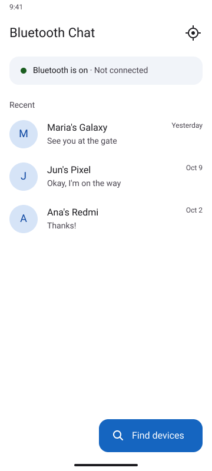
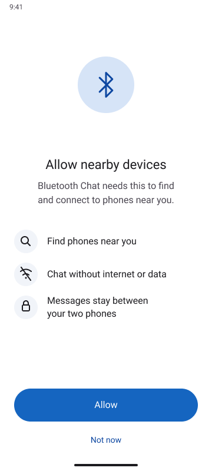
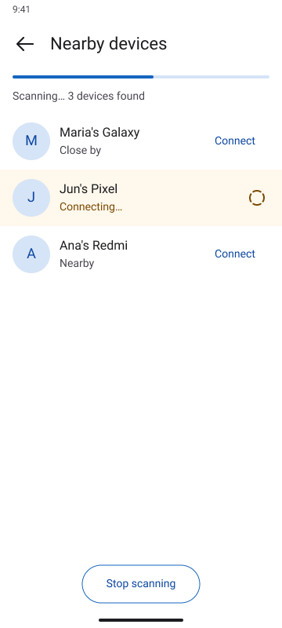
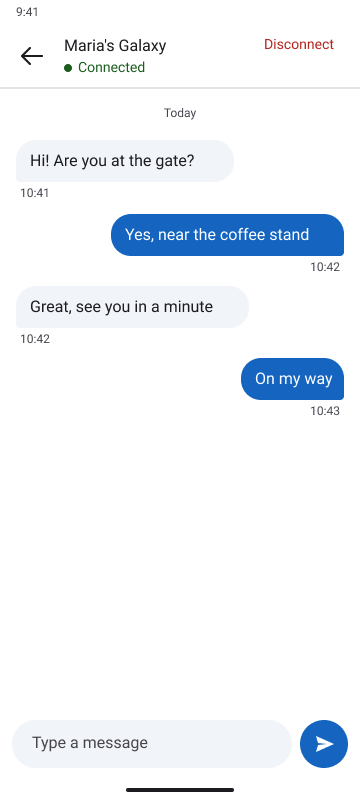

# Bluetooth Chat (BChat)

An Android chat app for nearby phones. It works over Bluetooth, with no internet, Wi-Fi, or mobile data.

Built with Kotlin and Bluetooth Classic (RFCOMM).

## Features

- Find nearby phones and connect
- Real-time messages with timestamps and usernames
- Send photos, with progress and cancel
- Reply to a specific message
- Delete a message for yourself, or unsend it for everyone
- "Is typing…" indicator
- Write to someone who is offline. Messages are delivered when you both connect again
- Chats keep working with the screen locked
- Recent chats saved on your phone
- Settings: name, visibility, chat history, and approval before connecting

## Screenshots

<p>
  
  
  
  
</p>

## Requirements

- Android 8.0 (API 26) or newer
- Two physical Android phones (Bluetooth does not work in the emulator)
- Android Studio

## Getting started

1. Clone the project:

```bash
   git clone https://github.com/kherphshikkii/BChat.git
```

2. Open it in Android Studio and let Gradle sync.
3. Turn on **Developer options** and **USB debugging** on each phone.
4. Pick a phone in the device dropdown and click **Run**. Repeat for the second phone.

## Try it with two phones

1. Open the app on both phones and allow the permissions.
2. On Phone B, tap the target icon on the home screen and choose **Allow**.
3. On Phone A, tap **Find devices**, then **Connect** next to Phone B.
4. The first time, confirm the pairing code on both phones.
5. Send a message each way.

## Permissions

| Android version | What the app asks for |
|---|---|
| 8 to 11 | Location (Android needs it for Bluetooth scanning, the app never reads your location) |
| 12 and newer | Nearby devices |
| 13 and newer | Notifications, for the connection notice |

## How it works

Both phones run the same app and use the same service ID. Each phone listens for connections, and tapping **Connect** opens a two-way Bluetooth socket. A small background service keeps the connection alive when the screen is off. Messages, photos, replies, and deletes are sent as small packets over that socket.

## Project structure

| File | Purpose |
|---|---|
| `PermissionActivity` | Asks for Bluetooth permissions |
| `HomeActivity` | Status card and recent chats |
| `DevicesActivity` | Scanning and device list |
| `MainActivity` | The chat screen |
| `SettingsActivity` | Name and privacy settings |
| `ImageViewerActivity` | Full-screen photos |
| `ChatConnection` | Bluetooth connection and message protocol |
| `ChatService` | Foreground service that keeps the connection alive |
| `ChatStore` | Saves chats on the phone |

## Troubleshooting

| Problem | Fix |
|---|---|
| The other phone never appears | Make it visible with the target icon |
| "Couldn't connect" every time | Choose **Forget** for the other phone in Bluetooth settings on both phones, then retry |
| Connecting hangs | Check the other phone for a pairing request |
| Nothing found on Android 11 or older | Turn on the Location switch |
| Messages or photos don't arrive | Install the same version on both phones |
| Connection drops when the screen locks | Set the app's battery use to **Unrestricted** |

## Known limits

- Range is about 10 meters in the open
- One chat connection at a time
- Offline messages need both phones to come back into range
- Photos are shrunk before sending, and they need a live connection

## Roadmap

- Message notifications and unread badges
- Delivery and seen ticks
- Dark mode
- Voice messages and files
- Longer range (Wi-Fi Direct or BLE)

## License

Released under the [MIT License](LICENSE).
